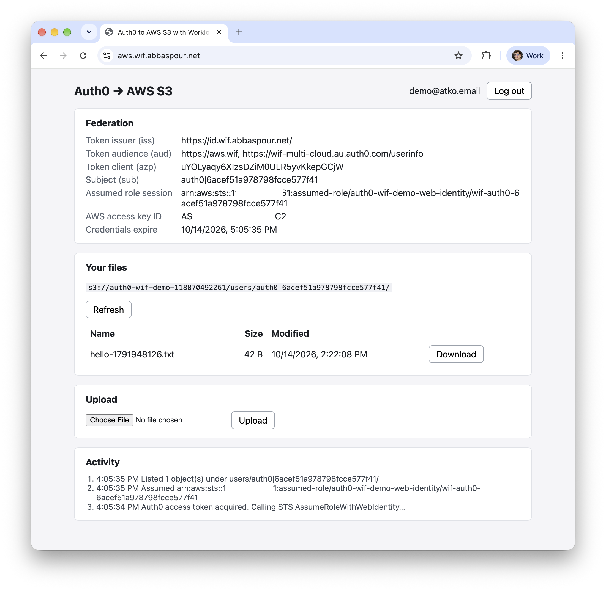
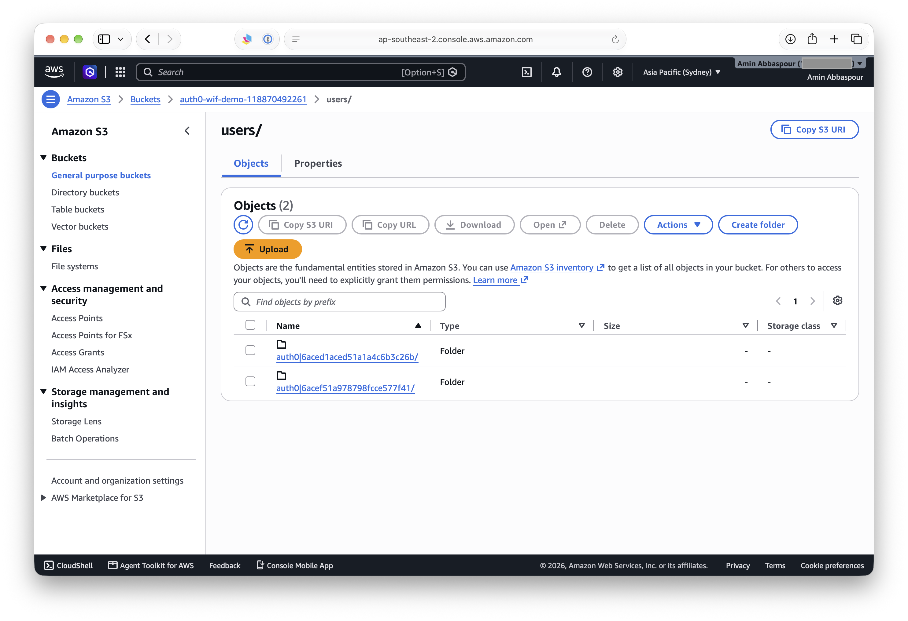

# AWS: Auth0 → IAM `AssumeRoleWithWebIdentity`

A user logs in with Auth0 and the browser exchanges the Auth0 access token with AWS STS for temporary credentials that only reach `users/<sub>/` in an S3 bucket. There is no backend and no long-lived AWS credentials anywhere.

## Overview


The diagram source is [`spa/sequence.puml`](spa/sequence.puml). After editing it, run `make diagram` in `aws/spa` (needs `plantuml` and `graphviz`) to regenerate the committed `spa/public/sequence.svg`, which the SPA also shows under its login button.

### What is in here

| Folder     | Purpose                                                                                 |
|------------|-----------------------------------------------------------------------------------------|
| `tf/`      | Terraform for both sides: Auth0 and AWS (one `apply` gives a working setup)             |
| `scripts/` | curl / AWS CLI scripts that verify the federation without any UI                        |
| `spa/`     | Vanilla-JS Vite demo app: log in, list, upload and download files in your own S3 prefix |
| `images/`  | Screenshots used below                                                                  |

Terraform creates:

- **Auth0:** an API (its identifier is the token audience), a SPA application and a native device-flow client for the scripts, a database connection with sign-up disabled, a test user, and optionally a custom domain.
- **AWS:** an IAM OIDC identity provider for the Auth0 issuer, a web-identity role, and an S3 bucket (public access blocked, CORS for the SPA origins, uploads expire after a few days).

### How the trust works

- Auth0 access tokens carry `azp` = the requesting client's ID. AWS maps `azp` (when present) to the `aud` condition key, so the IAM provider's `client_id_list` and the role's trust condition use the **client IDs** (SPA and CLI), not the API audience.
- The token's original `aud` is exposed as `oaud`. It is available in trust policies only, and the role requires it to match our API, so ID tokens and tokens for other APIs are rejected.
- `sub` is available in the role session, so one permissions policy restricts every user to `users/<sub>/*` with the policy variable `${<issuer-host>/:sub}`.

## Setup

### Prerequisites

1. **Auth0 M2M application for Terraform.** In the Auth0 dashboard, create a Machine-to-Machine application and authorize it for the *Auth0 Management API* with these scopes:
   `read:clients create:clients update:clients delete:clients`,
   `read:resource_servers create:resource_servers update:resource_servers delete:resource_servers`,
   `read:connections create:connections update:connections delete:connections`,
   `read:users create:users update:users delete:users`,
   `read:custom_domains create:custom_domains update:custom_domains delete:custom_domains` (only for the custom domain).
2. **AWS CLI profile** with permission to manage IAM and S3 in the target account.
3. Terraform >= 1.9 and `make`.
4. For the scripts: `curl` and `jq`. For the SPA: Node.js and npm.
5. Optional, for the custom domain and Cloudflare deployment: a DNS zone you control and a Cloudflare account that owns it.

### 1. Configure Terraform

```bash
cd aws/tf
cp terraform.auth.tfvars.example terraform.auth.tfvars   # gitignored; fill in your values
```

The required values are the Auth0 tenant domain and the M2M client credentials, the AWS profile (and region), and the test user's email and password (it must meet the connection's "fair" policy: 8+ characters with upper case, lower case and a number). The example file documents every variable.

### 2. Apply

```bash
make plan      # init + terraform plan -> saved plan file
make apply     # applies exactly that saved plan
make output    # role ARN, bucket, audience, client IDs, ...
```

`make help` lists all targets (`init`, `fmt`, `validate`, `destroy`).

### 3. Custom domain (optional, two stages)

The tenant gets an Auth0-managed custom domain (`auth0_custom_domain` in `tf/auth0.tf`), e.g. `id.wif.abbaspour.net`. Tokens issued through it carry `iss = https://id.wif.abbaspour.net/`, so once it is active the IAM OIDC provider trusts that issuer **only**, and the SPA and scripts log in against it (the `auth0_issuer_domain` output). Terraform's own Management API calls keep using `auth0_domain`.

1. Set `auth0_custom_domain = "id.wif.abbaspour.net"` in `terraform.auth.tfvars`, then `make plan && make apply`.
2. `make output`: `custom_domain_dns_records` lists the record to create (type, host, target). Add it in your DNS zone.
3. Set `auth0_custom_domain_verified = true`, then `make plan && make apply`. This verifies the domain, replaces the IAM OIDC provider with the custom-domain issuer and updates the role trust. If IAM reports it cannot fetch the discovery document, the certificate is still being issued: apply again in a few minutes.
4. Existing access tokens (old `iss`) stop working. Mint new ones with `scripts/device-token.sh`, and regenerate the SPA config with `scripts/spa-env.sh`.

A tenant normally has one custom domain, so later Azure and GCP demos share it rather than creating their own.

### 4. Deployed SPA host (optional)

`spa_domain = "aws.wif.abbaspour.net"` adds `https://aws.wif.abbaspour.net` to the SPA's Auth0 callback, logout and web-origin URLs and to the S3 CORS origins (alongside `spa_origins`, which defaults to `http://localhost:5173`). It must match the route in `spa/wrangler.jsonc`.

### 5. Install the SPA

```bash
cd aws/spa
../scripts/spa-env.sh   # writes .env.local from terraform output; rerun after any change to the outputs
npm install
```

### Things to know

- The SPA, CLI client and test user use a dedicated database connection (`<name_prefix>-users`) with **sign-up disabled**, because the deployed app is public. Only users created by Terraform or an admin can log in.
- Uploads under `users/` expire after `object_expiration_days` (default 7), and the SPA rejects files over 10 MB (IAM cannot cap object size).
- Changing the test user's connection replaces the user, which gets a new `sub`. Objects uploaded by the old user stay in the bucket under the old prefix until they expire.

## Running

### Verify federation with curl and the AWS CLI (`scripts/`)

The scripts read their settings from `terraform output` and make an unsigned STS call, so no AWS profile is needed.

```bash
cd aws/scripts

# 1. Log in (device flow): prints a URL and code; sign in as the test user.
#    -v prints the token's claims (iss, aud, azp, sub) to stderr.
./device-token.sh -v > .token

# 2. Exchange the Auth0 access token for temporary AWS credentials,
#    using curl against the STS HTTPS API:
./assume-role.sh -m curl -v > .creds.json
#    ...or the same exchange through the AWS CLI:
./assume-role.sh -m cli -v > .creds.json

# 3. Use the credentials against S3: allowed under users/<sub>/, denied elsewhere.
./s3-test.sh
```

`s3-test.sh` checks that the credentials can put, list and get under `users/<sub>/`, and are denied at the bucket root and under another user's prefix. It exits non-zero if any check fails. Run any script with `-h` for its options. `.token`, `.creds.json` and the other token files are gitignored.

**Trust policy checks (`trust-test.sh`).** Verifies that an access token for our API is accepted, and that an ID token and a token for another API are rejected. Re-run it whenever the trust policy changes.

```bash
# One login gives the access token and the ID token; a second login targets the other API.
./device-token.sh -i .id_token > .token
./device-token.sh -a https://other.wif > .token-other

./trust-test.sh -v       # -m cli to use the AWS CLI instead of curl
```

Access tokens requested with `openid` carry `aud` as an array (`[api, userinfo]`). The trust policy uses `ForAnyValue:StringEquals` on `oaud`, which matches when any element equals our API.

### Run the SPA locally

```bash
cd aws/spa
npm run dev             # http://localhost:5173 (fixed port: it is the Auth0 callback and S3 CORS origin)
npm test                # unit tests
```

The same goals exist as `make` targets in `aws/spa` (`make dev`, `build`, `preview`, `test`, `deploy`, `diagram`; they run `npm install` first when needed). `make help` lists them.

Log in as the Terraform test user. The page shows the token claims AWS evaluates, the assumed role session, when the credentials expire, and your files:



The same objects in the S3 console. Each user's files live under `users/<sub>/`; the two folders are the current test user and the one from before the dedicated connection replaced it:



How the SPA is built:

| File                 | Role                                                                                   |
|----------------------|----------------------------------------------------------------------------------------|
| `src/auth.js`        | Auth0 login (authorization code + PKCE, API audience), redirect callback, access token |
| `src/aws.js`         | Unsigned STS exchange, S3 list/upload/download                                         |
| `src/credentials.js` | Caches credentials, renews them (new Auth0 token + STS) 5 minutes before expiry        |
| `src/keys.js`        | `users/<sub>/` prefix and key building, shared contract with the role policy           |
| `src/main.js`        | UI                                                                                     |

### Deploy to Cloudflare Workers

`spa/wrangler.jsonc` configures an assets-only Worker (no script) that serves the Vite build as a single-page app on the custom domain `aws.wif.abbaspour.net`. To use another host, change `routes[0].pattern` and set the same value as `spa_domain` in Terraform.

```bash
cd aws/spa
../scripts/spa-env.sh     # the build bakes these values in; run it again after the custom domain is active
npm run deploy            # vite build && wrangler deploy
```

`wrangler` must be logged in (`npx wrangler login`) to an account that owns the zone. With the custom domain, the Auth0 domain and the SPA share the site `abbaspour.net`, so silent login on page reload works without third-party cookies.

### Notes

- The app never shows the secret key or session token, only the access key ID.
- A page reload relies on Auth0's silent authentication. Browsers that block third-party cookies show the login button again; the Auth0 session makes the second login instant. Refresh tokens are not used.
- Uploads read the whole file into memory, which is fine for a demo but not for large files.
- S3 object names are untrusted input and are rendered with `textContent` only.
- `make destroy` in `aws/tf` tears everything down (it asks for confirmation).
