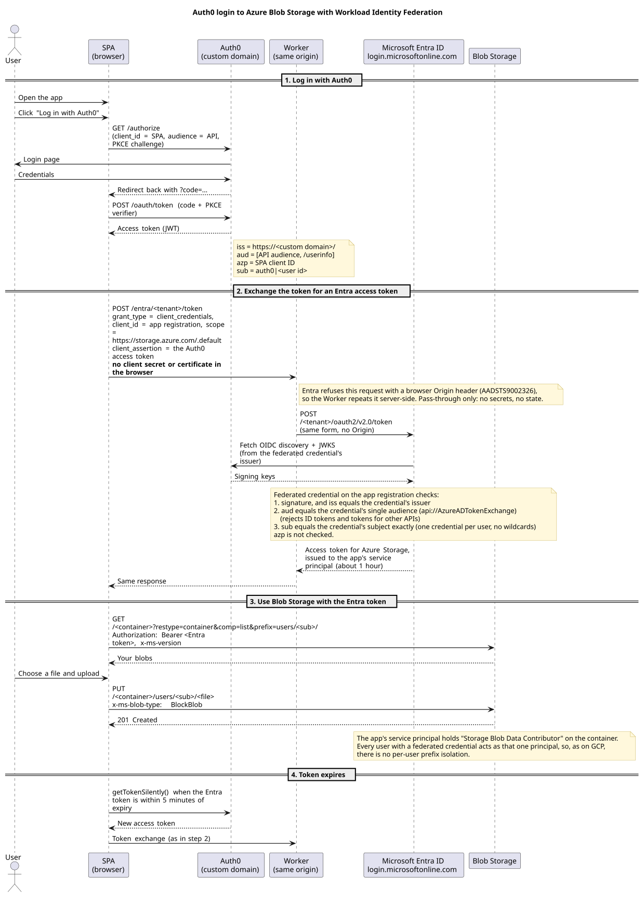
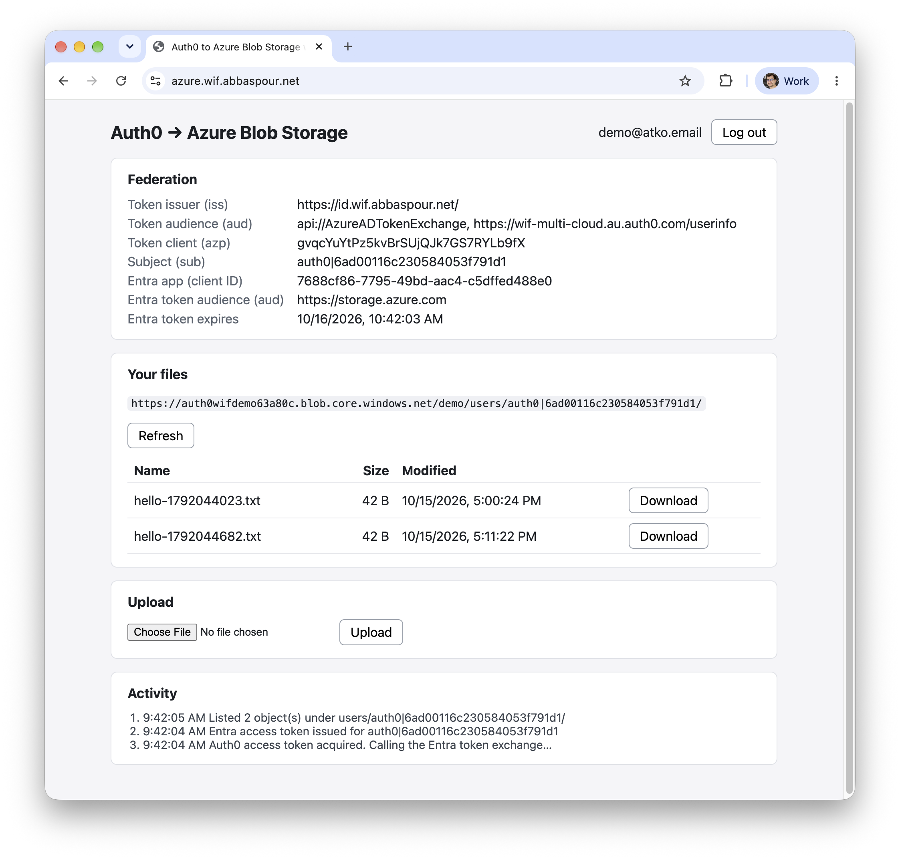
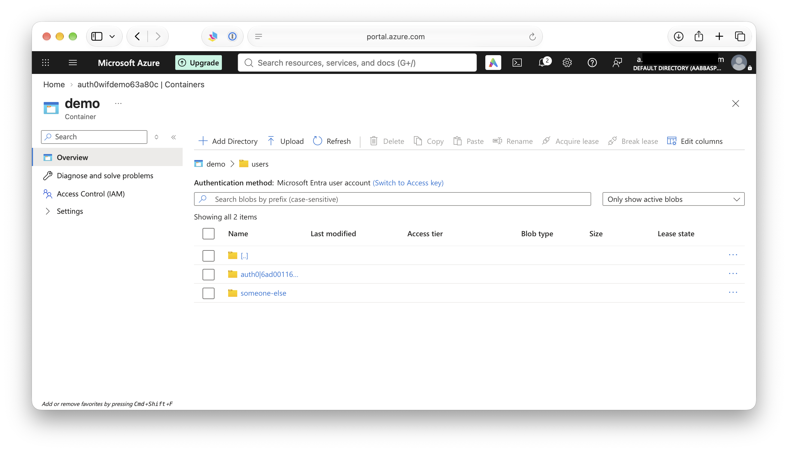

# Azure: Auth0 → Workload Identity Federation → Blob Storage

A user logs in with Auth0 and the browser exchanges the Auth0 access token with Microsoft Entra ID for a short-lived Entra access token, then calls Azure Blob Storage directly with it. There is no client secret or certificate: the Auth0 token itself is the app registration's credential. The one exception to "no backend" is a stateless pass-through for the token request, because Entra does not answer browser-origin `client_credentials` requests (see [Why a pass-through](#why-a-pass-through-for-the-token-request)).

## Overview



The diagram source is [`spa/sequence.puml`](spa/sequence.puml). After editing it, run `make diagram` in `azure/spa` (needs `plantuml` and `graphviz`) to regenerate the committed `spa/public/sequence.svg`, which the SPA also shows under its login button.

### What is in here

| Folder     | Purpose                                                                                                          |
|------------|------------------------------------------------------------------------------------------------------------------|
| `tf/`      | Terraform for the Azure side: app registration with federated credentials, storage account, role (Auth0 comes from `../auth0`) |
| `scripts/` | curl / Azure CLI scripts that verify the federation without any UI                                               |
| `spa/`     | Vanilla-JS Vite demo app: log in, list, upload and download files in a Blob Storage container, plus the Worker pass-through |

Terraform creates:

- **Auth0 (in [`../auth0`](../auth0)):** an API whose identifier is `api://AzureADTokenExchange`, a SPA application and a native device-flow client for the scripts. The database connection, test user and custom domain are shared with the other clouds.
- **Azure (in `tf/`):** an app registration and service principal, one federated identity credential per allowed Auth0 user, a resource group, a storage account (shared keys disabled, public access off, CORS for the SPA origins, uploads expire after a few days) with a private container, and a `Storage Blob Data Contributor` assignment for the service principal on that container.

### How the trust works

The script (or the SPA, through the pass-through below) sends `POST https://login.microsoftonline.com/<tenant>/oauth2/v2.0/token` with `grant_type=client_credentials`, the app registration's `client_id`, `scope=https://storage.azure.com/.default`, and the Auth0 access token as `client_assertion`. Entra fetches the issuer's signing keys and accepts the token only if a **federated identity credential** on the app matches it exactly:

- `issuer` equals the token's `iss` (the Auth0 custom domain once active, with its trailing slash).
- `audiences` holds one value and equals the token's `aud`. The Auth0 API identifier is `api://AzureADTokenExchange`, the value Microsoft recommends, so ID tokens and access tokens for other APIs are rejected. Auth0 access tokens requested with `openid` carry `aud` as an array (`[api, userinfo]`); Entra accepts it when one element matches.
- `subject` equals the token's `sub`. There are no wildcards, so **each allowed user needs their own credential** (an app allows 20). Terraform creates one for the test user plus any `additional_subjects`. A wrong subject is accepted at creation and only fails at exchange time.

Entra does not look at `azp`, so unlike AWS and GCP there is no check on which Auth0 client requested the token. A user who is not listed cannot exchange a token even though Auth0 will issue one to them.

Flexible (claim-matching) credentials would remove the per-user list, but Entra only supports them for GitHub, GitLab and Terraform Cloud issuers, and the Terraform providers cannot manage them, so this demo uses classic credentials.

### Why a pass-through for the token request

The token request is a plain cross-origin `POST`, but Entra answers a `client_credentials` request that carries a browser `Origin` header with `AADSTS9002326: Cross-origin token redemption is permitted only for the 'Single-Page Application' client-type`. Registering the SPA origins as SPA redirect URIs on the app does not change that (tested), and the same request without `Origin` (curl, the scripts) succeeds. So the SPA posts to its own origin at `/entra/<tenant>/token`, and a few lines of server code repeat the request without `Origin`:

- **Deployed:** the Cloudflare Worker in [`spa/worker/index.js`](spa/worker/index.js). Static files are served as assets without running it; only `/entra/*` reaches the script.
- **`npm run dev` / `preview`:** the Vite proxy in `spa/vite.config.js`, which strips the `Origin` header.

It holds no secrets and no state. The Auth0 access token in the request body is still the only credential, and the proxy only forwards the one request shape (`client_credentials`, the storage scope, a client assertion, a tenant GUID path, same-origin callers), so it is not an open relay. It does see the Auth0 token and the Entra token pass through. Blob Storage is still called directly from the browser.

**No per-user isolation.** AWS restricts each user to `users/<sub>/` with a policy variable; Azure RBAC has no equivalent. Every user with a credential acts as the same service principal, which holds the role on the whole container. The apps keep each user's files under `users/<sub>/`, but only by convention. Per-user isolation would need one app registration (or managed identity) per user, each with an ABAC condition on `users/<sub>/`, and the SPA would have to know which client ID to use.

## Setup

### Prerequisites

1. **The Auth0 side** from [`../auth0`](../auth0/README.md): apply it first (it creates the Azure API and clients and exposes the test user's `sub`). Set `azure_spa_domain` there if you will deploy the SPA.
2. **An Azure subscription** and the Azure CLI logged in for Terraform: `az login`. Your account needs two separate kinds of permission, see [Permissions](#permissions).
3. Terraform >= 1.9 and `make`.
4. For the scripts: `curl` and `jq` (and `az` for the `-m az` mode). For the SPA: Node.js and npm.
5. Optional, for the Cloudflare deployment: a Cloudflare account that owns the zone of the SPA host.

### Permissions

Terraform needs two separate permissions, and a role in one does not give you the other:

| Permission | System | Needed for | Typical role |
|---|---|---|---|
| Create resources and role assignments in the subscription | Azure RBAC | resource group, storage account, the app's `Storage Blob Data Contributor` assignment, registering the `Microsoft.Storage` provider | `Owner` on the subscription (or `Contributor` plus `User Access Administrator`) |
| Register applications in Entra | Entra directory roles | app registration, service principal, federated credentials | `Application Administrator` or `Global Administrator` |

A subscription you created yourself usually gives you both. Check what you have:

```bash
# Subscription and tenant the CLI is using (the subscription must match azure_subscription_id)
az account show --query "{subscription:id, tenant:tenantId, user:user.name}" -o table

# Azure RBAC roles: you need Owner (or User Access Administrator) at the subscription scope
az role assignment list --all --include-inherited --include-groups \
  --assignee "$(az ad signed-in-user show --query id -o tsv)" \
  --query "[].{role:roleDefinitionName, scope:scope}" -o table

# Entra directory roles: you want Application Administrator or Global Administrator
az rest --method GET --url "https://graph.microsoft.com/v1.0/me/memberOf/microsoft.graph.directoryRole" \
  --query "value[].displayName" -o tsv
```

Missing the RBAC role: an existing Owner grants it in the portal under **Subscriptions → your subscription → Access control (IAM) → Add → Add role assignment → Owner**, or with `az role assignment create --assignee <upn> --role Owner --scope /subscriptions/<id>`. Missing the Entra role: a Global Administrator grants it in the Entra admin center under **Roles & admins → Application Administrator → Add assignments**. Run `az login` again afterwards.

### 1. Configure and apply Azure

```bash
cd azure/tf
cp terraform.auth.tfvars.example terraform.auth.tfvars   # subscription ID (az account show --query id -o tsv) and region
make plan      # init + terraform plan -> saved plan file
make apply     # applies exactly that saved plan
make output    # tenant, app client ID, storage account, allowed subjects, ...
```

`make help` lists all targets (`init`, `fmt`, `validate`, `destroy`). The provider registers the `Microsoft.Storage` resource provider in the subscription when it starts (a new subscription has not registered it, and registering needs Contributor or Owner). New federated credentials and role assignments take a short while to propagate; if the first exchange fails right after `make apply`, retry in a minute or two.

### 2. Install the SPA

```bash
cd azure/spa
../scripts/spa-env.sh   # writes .env.local from terraform output
npm install
```

### Things to know

- Only users listed in the `allowed_subjects` output can exchange a token. To add a user, create them in Auth0 (the `users` connection has sign-up disabled), then add their user ID (`auth0|...`) to `additional_subjects` in `terraform.auth.tfvars` and apply again. Recreating the Terraform test user in `auth0/` gives it a new `sub`; re-apply `azure/tf` to move the credential.
- Auth0 access tokens requested with `openid` carry `aud` as an array (`[api, userinfo]`), which the SPA always requests. Entra accepts it when one element equals the credential's audience (verified; the "accept" case of `scripts/trust-test.sh` is the regression check).
- Uploads under `users/` expire after `object_expiration_days` (default 7), and the SPA rejects files over 10 MB.
- After changing the custom domain, re-apply `azure/tf` (the credentials' issuer changes) and mint new tokens with `scripts/device-token.sh`: tokens with the old `iss` are rejected.
- The storage account has shared keys disabled, so Terraform uses Entra ID for data-plane calls (`storage_use_azuread`). The Blob requests carry `x-ms-version`; any version from 2017-11-09 on accepts bearer tokens.

## Running

### Verify federation with curl and the Azure CLI (`scripts/`)

The scripts read their settings from `terraform output`, and the token exchange needs no Azure credentials.

```bash
cd azure/scripts

# 1. Log in (device flow): prints a URL and code; sign in as the test user.
#    -v prints the token's claims (iss, aud, azp, sub) to stderr.
./device-token.sh -v > .token

# 2. Exchange the Auth0 access token for an Entra access token for Azure Storage,
#    using curl against the Entra token endpoint:
./exchange.sh -m curl -v > .creds.json
#    ...or the same exchange through the Azure CLI (isolated config, your own az login is untouched):
./exchange.sh -m az -v > .creds.json

# 3. Use the token against Blob Storage: put, list and get under users/<sub>/.
./blob-test.sh
```

`blob-test.sh` also checks that an invalid token is rejected. Because access is container-wide, it expects another user's prefix to be reachable too; pass `-i` once you add per-user isolation to expect a denial instead. Run any script with `-h` for its options. `.token`, `.creds.json` and the other token files are gitignored.

**Trust checks (`trust-test.sh`).** Verifies that an access token for our API is accepted, and that an ID token and a token for another API are rejected. Re-run it whenever the credentials change.

```bash
# One login gives the access token and the ID token; a second login targets the other API.
./device-token.sh -i .id_token > .token
./device-token.sh -a "$(terraform -chdir=../tf output -raw other_api_audience)" > .token-other

./trust-test.sh -v       # -m az to use the Azure CLI instead of curl
```

### Run the SPA locally

```bash
cd azure/spa
npm run dev             # http://localhost:5173 (fixed port: it is the Auth0 callback and storage CORS origin)
npm test                # unit tests
```

The same goals exist as `make` targets in `azure/spa` (`make dev`, `build`, `preview`, `test`, `deploy`, `diagram`; they run `npm install` first when needed). `make help` lists them.

Log in as the Terraform test user. The page shows the Auth0 token claims Entra evaluated, the Entra app and token audience, when the Entra token expires, and your files.

The deployed app after login, showing the Auth0 token claims Entra evaluated (issuer on the custom domain, the `api://AzureADTokenExchange` audience as part of the `aud` array, SPA client as `azp`), the subject, the Entra app, the Entra token's own audience (`https://storage.azure.com`), and the user's files:



The same blobs in the Azure portal, under `demo/users/`. The `someone-else/` folder comes from `blob-test.sh`, which also writes outside the user's own prefix because access is container-wide. The portal lists blobs with your own Entra account, which needs a data role such as `Storage Blob Data Reader` on the storage account (an Owner does not have blob data access, and shared keys are disabled):



How the SPA is built:

| File                 | Role                                                                                   |
|----------------------|----------------------------------------------------------------------------------------|
| `src/auth.js`        | Auth0 login (authorization code + PKCE, API audience), redirect callback, access token |
| `src/azure.js`       | Entra token exchange (via `/entra/<tenant>/token`), Blob Storage REST API list/upload/download (plain `fetch`) |
| `worker/index.js`    | Cloudflare Worker: pass-through of the token request (only for `/entra/*`)              |
| `src/credentials.js` | Caches the Entra token, renews it (new Auth0 token + exchange) 5 minutes before expiry |
| `src/keys.js`        | `users/<sub>/` prefix and key building                                                 |
| `src/main.js`        | UI                                                                                     |

### Deploy to Cloudflare Workers

`spa/wrangler.jsonc` configures a Worker that serves the Vite build as a single-page app on the custom domain `azure.wif.abbaspour.net` and, for `/entra/*` only, runs the token pass-through script. To use another host, change `routes[0].pattern` and set the same value as `azure_spa_domain` in `auth0/`.

Before the first deploy:

1. Set `azure_spa_domain = "azure.wif.abbaspour.net"` in `auth0/terraform.auth.tfvars` and apply `auth0/`: this adds the host to the SPA client's callback, logout and web-origin URLs.
2. Apply `azure/tf` again: the storage account's CORS rule reads the same origin list from `auth0/`. (`make plan` shows a CORS change if you skipped this.)

```bash
cd azure/spa
../scripts/spa-env.sh     # the build bakes these values in; run it again after the custom domain is active
npm run deploy            # vite build && wrangler deploy
```

`wrangler` must be logged in (`npx wrangler login`) to an account that owns the zone. The first deploy creates the custom-domain record, so the host can take a minute or two to resolve.

### Troubleshooting

| Symptom | Cause |
|---|---|
| `terraform apply`: `AuthorizationFailed` on a role assignment, or `Authorization_RequestDenied` / `Insufficient privileges` on an `azuread_*` resource | Missing Azure RBAC role or Entra role, see [Permissions](#permissions) |
| `MissingSubscriptionRegistration` for a namespace | The resource provider is not registered in the subscription. `Microsoft.Storage` is registered by the provider block; for another one run `az provider register --namespace <name> --wait` |
| Token exchange: `AADSTS70021` (no matching federated identity record found) | The token's issuer, subject or audience does not match a credential. The error text prints the values Entra saw. The subject must be listed in `allowed_subjects`, and the issuer must be the active Auth0 domain with its trailing slash |
| Token exchange fails right after `make apply` | New credentials and role assignments take a minute or two to propagate |
| Blob call `403 AuthorizationPermissionMismatch` | The service principal's role assignment is missing or not propagated yet |
| Browser token request: `AADSTS9002326` | The request went to Entra directly instead of through `/entra/<tenant>/token` (the Vite proxy or the Worker), see [Why a pass-through](#why-a-pass-through-for-the-token-request) |
| Browser blocks a Blob call with a CORS error | The page's origin is not in the storage account's CORS rule: set the SPA domain in `auth0/` and apply `auth0/` and `azure/tf` |

### Notes

- The SPA never shows the access token, only its expiry and audience.
- A page reload relies on Auth0's silent authentication, as in the other demos. Refresh tokens are not used.
- The browser calls `<account>.blob.core.windows.net` directly (the token request goes through the pass-through above); the storage CORS rule allows the SPA origins and the `Authorization`, `Content-Type` and `x-ms-*` headers. Blob listings come back as XML and are parsed with `DOMParser`.
- Blob names are untrusted input and are rendered with `textContent` only.
- `make destroy` in `azure/tf` removes the Azure resources and the app registration; run it in `auth0/` too to remove the Auth0 side (both ask for confirmation).
