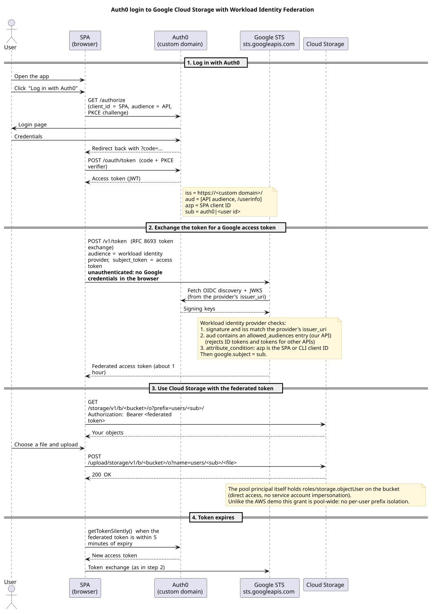
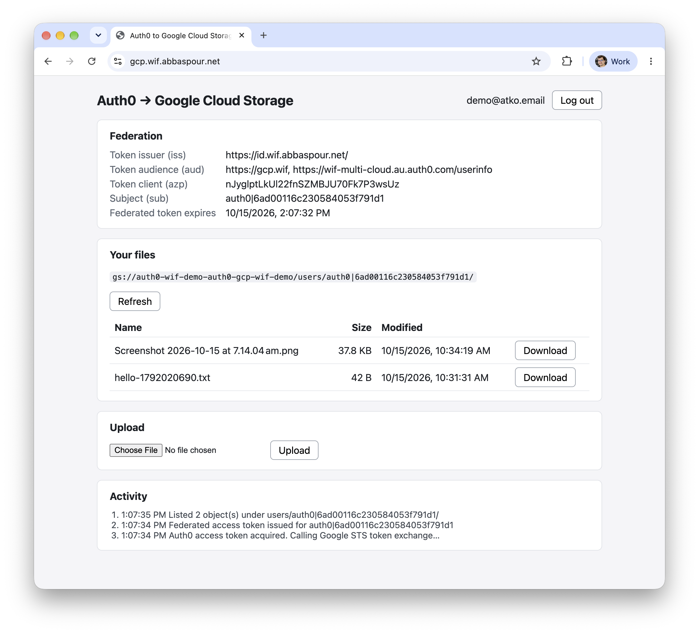
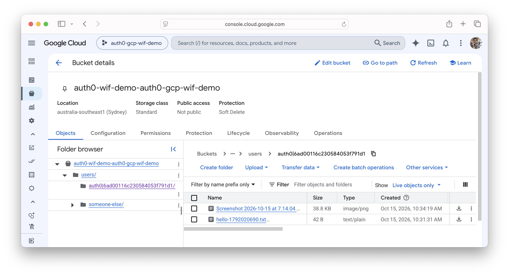

# GCP: Auth0 → Workload Identity Federation → Cloud Storage

A user logs in with Auth0 and the browser exchanges the Auth0 access token with Google STS for a short-lived Google access token, then calls Cloud Storage directly with it. There is no backend, no service account key and no service account impersonation: the federated identity itself holds the bucket role.

## Overview



The diagram source is [`spa/sequence.puml`](spa/sequence.puml). After editing it, run `make diagram` in `gcp/spa` (needs `plantuml` and `graphviz`) to regenerate the committed `spa/public/sequence.svg`, which the SPA also shows under its login button.

### What is in here

| Folder     | Purpose                                                                                                       |
|------------|---------------------------------------------------------------------------------------------------------------|
| `tf/`      | Terraform for the Google side: workload identity pool and provider, bucket, IAM (Auth0 comes from `../auth0`) |
| `scripts/` | curl / gcloud scripts that verify the federation without any UI                                               |
| `spa/`     | Vanilla-JS Vite demo app: log in, list, upload and download files in a Cloud Storage bucket                   |

Terraform creates:

- **Auth0 (in [`../auth0`](../auth0)):** an API (its identifier is the token audience), a SPA application and a native device-flow client for the scripts. The database connection, test user and custom domain are shared with the other clouds.
- **Google Cloud (in `tf/`):** a workload identity pool with an OIDC provider for the Auth0 issuer, a Cloud Storage bucket (public access prevented, CORS for the SPA origins, uploads expire after a few days), and an IAM grant on the bucket for the pool.

### How the trust works

- The provider's `issuer_uri` is the Auth0 issuer (the custom domain once active). Google fetches `/.well-known/openid-configuration` and the signing keys from it.
- `allowed_audiences` is the API audience, so ID tokens and access tokens for other APIs are rejected. Auth0 access tokens requested with `openid` carry `aud` as an array (`[api, userinfo]`); the exchange accepts it when any element matches (verified; `scripts/trust-test.sh` is the regression check).
- `attribute_condition` only accepts tokens whose `azp` is the SPA or CLI client ID, the counterpart of the AWS `client_id_list`. `google.subject` is mapped from `sub`.
- Access is **direct resource access**: `roles/storage.objectUser` on the bucket is granted to the pool's `principalSet://iam.googleapis.com/projects/<number>/locations/global/workloadIdentityPools/<pool>/*`, so the federated token is used on Cloud Storage as is.
- **No per-user isolation.** AWS restricts each user to `users/<sub>/` with a policy variable; IAM has no equivalent, so this demo grants every identity in the pool the same bucket access. The apps still keep each user's files under `users/<sub>/`, but only by convention. Because sign-up is disabled in Auth0, only users you create can log in. Per-user isolation would need one binding per user (`principal://…/subject/<sub>` with an IAM condition on `users/<sub>/`), created from a user list in Terraform.

## Setup

### Prerequisites

1. **The Auth0 side** from [`../auth0`](../auth0/README.md): apply it first (it creates the GCP API and clients). Set `gcp_spa_domain` there if you will deploy the SPA.
2. **A Google Cloud project** with billing enabled, and `gcloud` logged in for Terraform: `gcloud auth application-default login`. The account needs to manage IAM workload identity pools, Cloud Storage and service enablement in the project (for example `roles/owner`).
3. Terraform >= 1.9 and `make`.
4. For the scripts: `curl` and `jq` (and `gcloud` for the `-m gcloud` mode). For the SPA: Node.js and npm.
5. Optional, for the Cloudflare deployment: a Cloudflare account that owns the zone of the SPA host.

### 1. Configure and apply Google Cloud

```bash
cd gcp/tf
cp terraform.auth.tfvars.example terraform.auth.tfvars   # project ID and region
make plan      # init + terraform plan -> saved plan file
make apply     # applies exactly that saved plan
make output    # provider audience, bucket, client IDs, ...
```

`make help` lists all targets (`init`, `fmt`, `validate`, `destroy`). Terraform enables the `iam`, `sts` and `storage` APIs. If the custom domain was just verified, the provider creation can fail while Google cannot yet fetch the discovery document; apply again in a few minutes.

### 2. Install the SPA

```bash
cd gcp/spa
../scripts/spa-env.sh   # writes .env.local from terraform output
npm install
```

### Things to know

- Workload identity pool and provider IDs are soft-deleted for about 30 days after `make destroy` and cannot be reused in that time. Change `name_prefix` to redeploy under a new ID right away.
- Uploads under `users/` expire after `object_expiration_days` (default 7), and the SPA rejects files over 10 MB (IAM cannot cap object size).
- After changing the custom domain, mint new tokens with `scripts/device-token.sh`: tokens with the old `iss` are rejected.

## Running

### Verify federation with curl and gcloud (`scripts/`)

The scripts read their settings from `terraform output`, and the token exchange is unauthenticated, so no Google credentials are needed.

```bash
cd gcp/scripts

# 1. Log in (device flow): prints a URL and code; sign in as the test user.
#    -v prints the token's claims (iss, aud, azp, sub) to stderr.
./device-token.sh -v > .token

# 2. Exchange the Auth0 access token for a Google access token,
#    using curl against sts.googleapis.com:
./exchange.sh -m curl -v > .creds.json
#    ...or the same exchange through gcloud (isolated config, your own gcloud accounts are untouched):
./exchange.sh -m gcloud -v > .creds.json

# 3. Use the token against Cloud Storage: put, list and get under users/<sub>/.
./gcs-test.sh
```

`gcs-test.sh` also checks that an invalid token is rejected. Because access is pool-wide, it expects another user's prefix to be reachable too; pass `-i` once you add per-user isolation to expect a denial instead. If Cloud Storage reports a missing quota or billing project, pass `-p <project id>` to send `x-goog-user-project`. Run any script with `-h` for its options. `.token`, `.creds.json` and the other token files are gitignored.

**Trust checks (`trust-test.sh`).** Verifies that an access token for our API is accepted, and that an ID token and a token for another API are rejected. Re-run it whenever the provider changes.

```bash
# One login gives the access token and the ID token; a second login targets the other API.
./device-token.sh -i .id_token > .token
./device-token.sh -a "$(terraform -chdir=../tf output -raw other_api_audience)" > .token-other

./trust-test.sh -v       # -m gcloud to use gcloud instead of curl
```

### Run the SPA locally

```bash
cd gcp/spa
npm run dev             # http://localhost:5173 (fixed port: it is the Auth0 callback and bucket CORS origin)
npm test                # unit tests
```

The same goals exist as `make` targets in `gcp/spa` (`make dev`, `build`, `preview`, `test`, `deploy`, `diagram`; they run `npm install` first when needed). `make help` lists them.

Log in as the Terraform test user. The page shows the token claims Google evaluates, the subject, when the federated token expires, and your files.

The deployed app after login, showing the token claims Google evaluated (issuer on the custom domain, API audience, SPA client as `azp`), the subject, and the user's files:



The same objects in the Cloud Storage console under `users/<sub>/`. The `someone-else/` folder comes from `gcs-test.sh`, which also writes outside the user's own prefix because access is pool-wide:



How the SPA is built:

| File                 | Role                                                                                   |
|----------------------|----------------------------------------------------------------------------------------|
| `src/auth.js`        | Auth0 login (authorization code + PKCE, API audience), redirect callback, access token |
| `src/gcp.js`         | Google STS token exchange, Cloud Storage JSON API list/upload/download (plain `fetch`) |
| `src/credentials.js` | Caches the federated token, renews it (new Auth0 token + STS) 5 minutes before expiry  |
| `src/keys.js`        | `users/<sub>/` prefix and key building                                                 |
| `src/main.js`        | UI                                                                                     |

### Deploy to Cloudflare Workers

`spa/wrangler.jsonc` configures an assets-only Worker (no script) that serves the Vite build as a single-page app on the custom domain `gcp.wif.abbaspour.net`. To use another host, change `routes[0].pattern` and set the same value as `gcp_spa_domain` in `auth0/`.

```bash
cd gcp/spa
../scripts/spa-env.sh     # the build bakes these values in; run it again after the custom domain is active
npm run deploy            # vite build && wrangler deploy
```

`wrangler` must be logged in (`npx wrangler login`) to an account that owns the zone.

### Notes

- The SPA never shows the access token, only its expiry.
- A page reload relies on Auth0's silent authentication, as in the AWS demo. Refresh tokens are not used.
- Uploads send the `File` as the request body. The browser calls `sts.googleapis.com` and `storage.googleapis.com` directly; the bucket CORS rule allows the SPA origins and the `Authorization` and `Content-Type` headers.
- Object names are untrusted input and are rendered with `textContent` only.
- `make destroy` in `gcp/tf` removes the Google resources; run it in `auth0/` too to remove the Auth0 side (both ask for confirmation).
